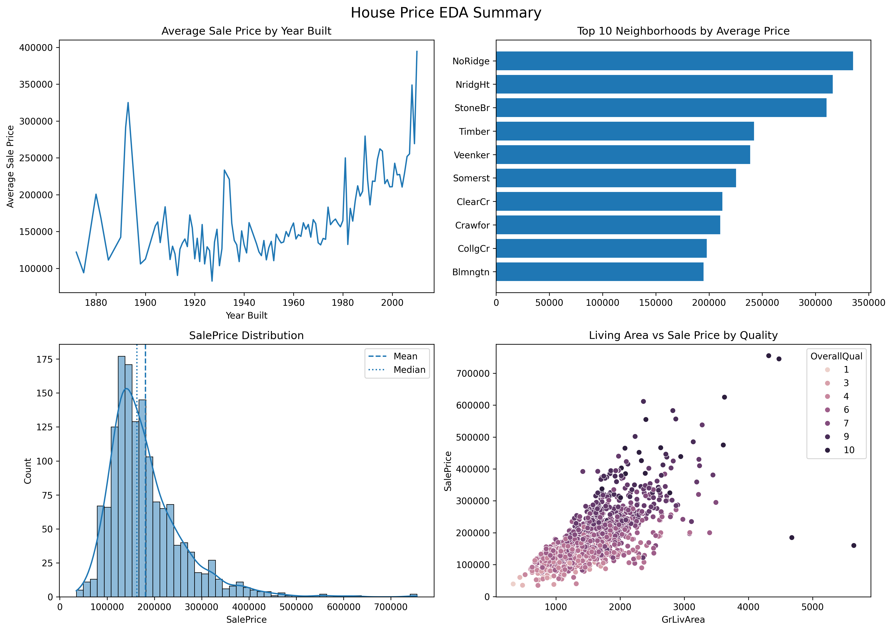

# House Price Exploratory Data Analysis (EDA)

## Project Overview
This project performs Exploratory Data Analysis (EDA) on the Ames Housing dataset to understand the factors influencing residential house prices.

## Objectives
- Understand and clean the dataset.
- Analyze numerical, categorical, and ordinal variables.
- Study house price distributions.
- Explore correlations between house features and SalePrice.
- Detect and analyze outliers.
- Create a visual dashboard summarizing key findings.

## Tools and Technologies
- Python
- Pandas and NumPy
- Matplotlib and Seaborn
- SciPy
- Google Colab

## Key Analysis
- Descriptive statistics
- Univariate and multivariate analysis
- Correlation and covariance analysis
- IQR and Z-score outlier detection
- Missing-value handling and data quality checks
- 2×2 EDA dashboard

## Dashboard

## Project Files
- `EDA_House_Price_Analysis.ipynb` – Complete EDA notebook.
- `eda_dashboard.png` – Final visualization dashboard.

## Dataset
Ames Housing Dataset – Kaggle.

## Conclusion
The analysis shows that overall quality, living area, and neighborhood are important factors associated with house sale prices. The project demonstrates how EDA helps identify patterns, relationships, and unusual observations in real-world datasets.
